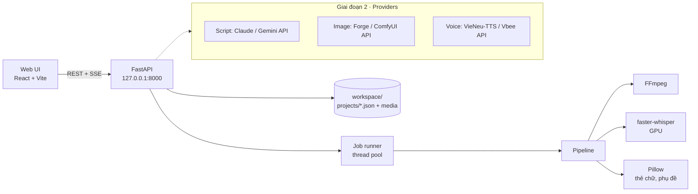

# HBT Studio — Kế hoạch

> Web app chạy **local** để sản xuất video ngắn cho kênh **Hay Biết Tuốt** (TikTok, YouTube Shorts, Facebook Reels).
> Phiên bản kế hoạch: v1.4 · 21/10/2026 · Chủ dự án: Thong · Người code: Claude Code
> File chi tiết kỹ thuật: [`IMPLEMENT.md`](IMPLEMENT.md) · Quy tắc cho Claude Code: [`CLAUDE.md`](CLAUDE.md)

---

## 1. Bài toán

Quy trình hiện tại làm tay qua 4 công cụ:

```
Claude (kịch bản) → Gemini web (8 ảnh) → Vbee (giọng đọc) → Pixabay (nhạc) → Claude (dựng video)
```

Điểm nghẽn: bước dựng phụ thuộc vào chat; phụ đề karaoke chỉ ước lượng (lệch 0,1–0,2 giây); mỗi video mất nhiều lượt gửi file qua lại.

**Mục tiêu:** một web app local gom mọi bước về một chỗ. Bạn chỉ nhập nội dung, duyệt, bấm Xuất.

## 2. Phạm vi theo giai đoạn

| Giai đoạn | Nội dung | Kết quả |
|---|---|---|
| **1 · Studio dựng video** (làm ngay) | Kéo thả ảnh, giọng, nhạc + soạn thẻ chữ, lời đọc → app tự dựng video 50fps có phụ đề karaoke chính xác (Whisper), ducking nhạc, kiểm tra từ nhạy cảm, sinh sẵn title/description | Không cần gửi file cho Claude để dựng nữa |
| **2 · Tạo nội dung tự động** | Nối API: kịch bản (Claude/Gemini), ảnh (Forge/ComfyUI chạy trên GPU), giọng (VieNeu-TTS local hoặc Vbee API), tự chọn nhạc từ thư viện theo tâm trạng | Nhập 1 chủ đề → ra bản nháp đầy đủ để duyệt |
| **3 · Mở rộng** (sau) | Hàng đợi nhiều video, template theo series, lịch đăng, thống kê | Sản xuất hàng loạt |

**Ngoài phạm vi:** tự đăng lên TikTok/YouTube (cần duyệt API nhà phát triển), chạy trên internet, nhiều người dùng.

## 3. Nguyên tắc

1. **Chạy local, dữ liệu ở máy bạn.** Server chỉ mở ở `127.0.0.1`.
2. **Con người duyệt ở 3 điểm:** kịch bản → ảnh → video cuối. AI không được tự đăng.
3. **Kịch bản là nguồn chữ chuẩn.** Phụ đề lấy chữ từ kịch bản, Whisper chỉ cung cấp mốc thời gian.
4. **Tái sử dụng logic đã kiểm chứng** ở `reference/pipeline/` (đã dựng 6 video thật).
5. **Mã nguồn trên Git, media không lên Git** (`workspace/` bị ignore).

## 4. Kiến trúc



## 5. Công nghệ đề xuất

| Lớp | Chọn | Lý do |
|---|---|---|
| Giao diện | **React + TypeScript + Vite** | Nhẹ, nhanh, Claude Code viết tốt |
| Style | **Tailwind CSS** + token lấy từ `DESIGN.md` | Áp phong cách từ getdesign dễ nhất qua biến CSS |
| Dữ liệu phía client | TanStack Query, dnd-kit (kéo đổi thứ tự cảnh), react-dropzone | Ít tự viết lại |
| Backend | **Python 3.11 + FastAPI** | Toàn bộ pipeline (Pillow, FFmpeg, Whisper) đã viết bằng Python |
| Lưu trữ | File JSON mỗi project + thư mục media | Dễ đọc, dễ sao lưu, không cần DB ở GĐ1 |
| Tiến trình dựng | Thread pool + SSE báo tiến độ | Đủ cho 1 người dùng |
| Phụ đề chính xác | **faster-whisper large-v3** (int8 trên RTX 2060 Super 8 GB) | Mốc thời gian từng chữ; dự phòng: căn theo khoảng lặng |
| Dựng video | **FFmpeg ≥ 6** | Lệnh đã kiểm chứng trong `reference/` |
| Kiểm thử | pytest, Vitest | |
| Chất lượng code | ruff, ESLint, Prettier | |

**Thương hiệu:** logo, tên app (**HBT Studio**) và màu nhấn là của **Hay Biết Tuốt** (thư mục `brand/`). Nike chỉ là nguồn cảm hứng về phong cách.

**Về giao diện tham khảo Nike:** lệnh `npx getdesign@0.6.20 add nike` (ghim phiên bản) tải một file `DESIGN.md` mô tả màu, chữ, khoảng cách theo phong cách Nike vào gốc repo. Theo README của getdesign, các file này chỉ là file lấy cảm hứng, không phải design system chính thức của thương hiệu. Vì vậy:
- Chỉ lấy **phong cách** (độ tương phản đen trắng mạnh, chữ đậm, bố cục thoáng), **không** dùng logo, wordmark hay tên Nike trong app.
- Font chữ dùng **Be Vietnam Pro** (đã kèm trong repo) để hiển thị tiếng Việt chuẩn, thay cho font của Nike.
- **Đọc lại `DESIGN.md` trước khi đưa Claude Code dùng**, vì đây là nội dung bên thứ ba sẽ điều khiển cách AI viết code.

## 6. Lộ trình Giai đoạn 1

Ước lượng theo buổi làm việc với Claude Code (~3 giờ/buổi).

| Mốc | Việc | Buổi | Kiểm chứng |
|---|---|---|---|
| **M0** · Khởi tạo | Repo, cấu trúc thư mục, script chạy 1 lệnh, CI lint | 0,5 | `npm run dev` mở được trang trống + API `/health` |
| **M1** · Bộ dựng | Port `reference/pipeline` → `render.py`, CLI `hbt render <project>` | 2 | Dựng lại video "muỗi" từ project mẫu, ra file 50fps, -14 LUFS |
| **M2** · API | CRUD project, tải file, job dựng + SSE, ảnh xem trước từng cảnh | 1,5 | Gọi API bằng curl dựng được video |
| **M3** · Giao diện | Danh sách project, trình soạn cảnh, nhạc, xuất video, xem video | 2,5 | Làm trọn 1 video chỉ bằng giao diện |
| **M4** · Hoàn thiện | Whisper, kiểm tra từ nhạy cảm, sinh title/description, thư viện nhạc | 1,5 | Phụ đề lệch < 0,05 giây; cảnh báo khi kịch bản có "bia", "máu"… |
| **Tổng** | | **~8 buổi** | |

## 7. Rủi ro

| Rủi ro | Cách giảm |
|---|---|
| Whisper nhận sai tiếng Việt | Kịch bản là nguồn chữ; chỉ lấy thời gian; có chế độ dự phòng theo khoảng lặng |
| Dựng 60fps chậm trên máy | Có nút **Xem nhanh** (540×960, 30fps) để duyệt trước, chỉ xuất bản đẹp khi đã ưng |
| Thiếu VRAM khi chạy Whisper + tạo ảnh cùng lúc | Giải phóng model Whisper sau khi căn xong; không chạy song song 2 job nặng |
| Bản quyền nhạc | Thư viện nhạc lưu nguồn + giấy phép từng bài; description tự chèn dòng ghi công |
| Nội dung nhạy cảm | Danh sách từ cấm/cảnh báo có thể chỉnh, chạy trước khi xuất |
| `DESIGN.md` bên thứ ba | Ghim phiên bản `getdesign`, đọc duyệt trước, ghim vào Git, không chạy lại tự động |
| Vướng thương hiệu Nike | Chỉ học phong cách; logo, tên, font độc quyền, khẩu hiệu của Nike đều không dùng |

## 8. Quy trình làm việc với Git

- Nhánh `main` luôn chạy được; mỗi mốc một nhánh `feat/m1-render-engine`…
- Commit theo Conventional Commits (`feat:`, `fix:`, `docs:`).
- Sau mỗi mốc: tag `v0.1.0`, `v0.2.0`…, cập nhật bảng tiến độ ở cuối file này.

## 9. Bối cảnh kênh (để hiểu vì sao app thiết kế như vậy)

**Quy trình sản xuất đang dùng (làm tay, sẽ được app thay thế dần):**

| Bước | Công cụ hiện tại | Ghi chú |
|---|---|---|
| Chọn chủ đề + viết kịch bản 8 cảnh | Claude | Mỗi kịch bản kèm: lời đọc, thẻ chữ, prompt ảnh, **thể loại nhạc nền + từ khoá tìm Pixabay** |
| Tạo 8 ảnh | Gemini (1 tin nhắn ra 8 ảnh) | Phong cách cắt dán giấy, khổ dọc 9:16, **không chữ trong ảnh** |
| Giọng đọc | Vbee (hoặc tự thu) | Số và tên nước ngoài viết theo cách đọc |
| Nhạc nền | Pixabay Music | Lưu tên bài + tác giả để ghi công |
| Dựng video | Claude (code Python + FFmpeg) | Đã làm 6 video, code nằm ở `reference/pipeline/` |

**Quy tắc nội dung (app phải hỗ trợ kiểm tra):**
- Tránh từ và hình nhạy cảm: rượu bia, máu me, hoá chất nghe đáng sợ, bạo lực, thuốc men, chính trị.
- Không để AI vẽ bản đồ Việt Nam (dễ thiếu Hoàng Sa, Trường Sa); không để AI vẽ chữ tiếng Việt.
- Số liệu trong kịch bản phải có nguồn kiểm chứng.

**Các series:** "Vì sao…" (văn hoá), "Vì sao Trái Đất…" (khoa học, tông xanh), "Vì sao vậy ta?" (đời sống, tông vàng–san hô–xanh két).

## 10. Nhật ký quyết định

| Ngày | Quyết định | Lý do |
|---|---|---|
| 20/10/2026 | Làm web app local, mã nguồn trên Git, media không lên Git | Dễ quản lý, không tốn phí server |
| 20/10/2026 | Thử **60fps** (không dùng 45fps) | 60fps là chuẩn mượt; 45fps có thể bị nền tảng chuyển đổi gây giật |
| 21/10/2026 | **Mặc định 50fps** + easing + phóng nội bộ 3 lần + chuyển cảnh nhoè chuyển động + mã hoá chất lượng cao (IMPLEMENT mục 4b) | Chủ dự án so sánh thấy mượt hơn; chống mất nét khi nền tảng nén lại. Đã dựng lại 5 video cũ theo chuẩn này |
| 21/10/2026 | Thêm **outro 4 giây** kêu gọi theo dõi TikTok + YouTube (IMPLEMENT mục 4c) | Tăng lượt theo dõi kênh; dùng chung mọi video |
| 21/10/2026 | Lời đọc **≤ 750 ký tự/video**; **cắt đoạn quảng cáo cuối file Vbee** (IMPLEMENT mục 4d) | Gói Vbee giới hạn 3.000 ký tự/ngày; không để người xem nghe quảng cáo |
| 21/10/2026 | Mỗi video có **ảnh bìa** (9:16 cho TikTok/Reels, cắt 3:2 cho YouTube Shorts), làm cùng lúc với video (IMPLEMENT mục 4e) | Không phải làm bìa tay riêng cho từng video; dùng chung bộ chữ, logo HBT |
| 20/10/2026 | Phụ đề karaoke mặc định cho mọi video, căn bằng **faster-whisper** | Hết lệch 0,1–0,2 giây so với cách ước lượng cũ |
| 20/10/2026 | Thương hiệu **HBT** (logo trong `brand/`), giao diện **học phong cách Nike** qua `DESIGN.md` | Đẹp, trực quan; không dùng tài sản thương hiệu Nike |
| 20/10/2026 | Ghim `getdesign@0.6.20`, duyệt `DESIGN.md` trước khi commit | Giảm rủi ro chạy code và nội dung bên thứ ba |
| 20/10/2026 | Giữ 3 điểm duyệt của con người: kịch bản → ảnh → video | Tránh lỗi chữ, bản đồ, từ nhạy cảm lọt lên mạng |
| 20/10/2026 | `/health`: `ok` chỉ khi FFmpeg chạy được và đủ `libx264` + filter `zoompan`, `xfade`, `sidechaincompress`, `loudnorm`, `silencedetect`; trả danh sách `missing` (IMPLEMENT.md mục 9) | Biết ngay máy có dựng được video không; Whisper và GPU đã có đường dự phòng |
| 20/10/2026 | Claude Code phải hỏi trước khi cài, gỡ, nâng cấp phần mềm cấp hệ thống; gói trong `backend/.venv` và npm của dự án thì được tự cài | Chủ dự án kiểm soát máy; tránh thay đổi hệ thống ngoài ý muốn |
| 20/10/2026 | Không tự push lên GitHub; chỉ push khi chủ dự án yêu cầu | Chủ dự án duyệt trước những gì công khai lên remote |
| 20/10/2026 | Giữ tag `v0.1.0` (commit tài liệu, đã push); bản M0 gắn `v0.1.1` (merge `f329c8e`); không force-push | Tag đã công khai thì không ghi đè |
| 20/10/2026 | Whoosh cảnh cú lật: tại offset xfade của cảnh (cảnh 1 thì 0 s), âm lượng 0,30 trước loudnorm tổng (IMPLEMENT.md mục 6.3) | Giống thông số 6 video đã đăng |
| 20/10/2026 | Cho dựng video không nhạc: bỏ ducking, giọng −14 LUFS, xuất stereo (IMPLEMENT.md mục 6.4) | Đã có video cũ không dùng nhạc |
| 20/10/2026 | M1 làm luôn `models.py`, tự chọn đoạn nhạc, `publish.txt`; lint từ nhạy cảm để M4 (IMPLEMENT.md mục 11) | `render.py` cần các phần này để chạy trọn |

## 11. Tiến độ

| Mốc | Trạng thái | Ghi chú |
|---|---|---|
| M0 | ☑ | Chủ dự án duyệt 20/10/2026 · tag `v0.1.1` |
| M1 | ☐ | Đang làm trên nhánh `feat/m1-render-engine` |
| M2 | ☐ | |
| M3 | ☐ | |
| M4 | ☐ | |
