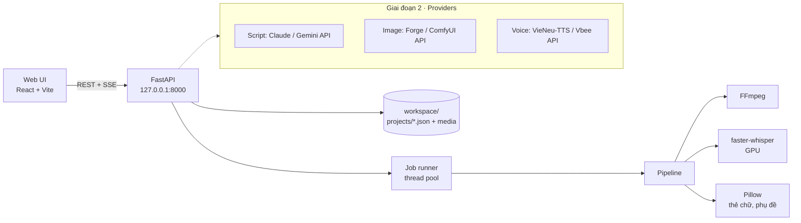

# HBT Studio — Kế hoạch

> Web app chạy **local** để sản xuất video ngắn cho kênh **Hay Biết Tuốt** (TikTok, YouTube Shorts, Facebook Reels).
> Phiên bản kế hoạch: v1.4 · 21/10/2026 · Chủ dự án: Thong · Người code: Claude Code
> File chi tiết kỹ thuật: [`IMPLEMENT.md`](IMPLEMENT.md) · Quy tắc cho Claude Code: [`CLAUDE.md`](CLAUDE.md)

---

## 1. Bài toán

Quy trình hiện tại làm tay qua 4 công cụ:

```
Claude (kịch bản) → Gemini web (8 ảnh) → Vbee (giọng đọc) → Pixabay (nhạc) → Claude (dựng video)
```

Điểm nghẽn: bước dựng phụ thuộc vào chat; phụ đề karaoke chỉ ước lượng (lệch 0,1–0,2 giây); mỗi video mất nhiều lượt gửi file qua lại.

**Mục tiêu:** một web app local gom mọi bước về một chỗ. Bạn chỉ nhập nội dung, duyệt, bấm Xuất.

## 2. Phạm vi theo giai đoạn

| Giai đoạn | Nội dung | Kết quả |
|---|---|---|
| **1 · Studio dựng video** (làm ngay) | Kéo thả ảnh, giọng, nhạc + soạn thẻ chữ, lời đọc → app tự dựng video 50fps có phụ đề karaoke chính xác (Whisper), ducking nhạc, kiểm tra từ nhạy cảm, sinh sẵn title/description | Không cần gửi file cho Claude để dựng nữa |
| **2 · Tạo nội dung tự động** | Nối API: kịch bản (Claude/Gemini), ảnh (Forge/ComfyUI chạy trên GPU), giọng (VieNeu-TTS local hoặc Vbee API), tự chọn nhạc từ thư viện theo tâm trạng | Nhập 1 chủ đề → ra bản nháp đầy đủ để duyệt |
| **3 · Mở rộng** (sau) | Hàng đợi nhiều video, template theo series, lịch đăng, thống kê | Sản xuất hàng loạt |

**Ngoài phạm vi:** tự đăng lên TikTok/YouTube (cần duyệt API nhà phát triển), chạy trên internet, nhiều người dùng.

## 3. Nguyên tắc

1. **Chạy local, dữ liệu ở máy bạn.** Server chỉ mở ở `127.0.0.1`.
2. **Con người duyệt ở 3 điểm:** kịch bản → ảnh → video cuối. AI không được tự đăng.
3. **Kịch bản là nguồn chữ chuẩn.** Phụ đề lấy chữ từ kịch bản, Whisper chỉ cung cấp mốc thời gian.
4. **Tái sử dụng logic đã kiểm chứng** ở `reference/pipeline/` (đã dựng 6 video thật).
5. **Mã nguồn trên Git, media không lên Git** (`workspace/` bị ignore).

## 4. Kiến trúc



## 5. Công nghệ đề xuất

| Lớp | Chọn | Lý do |
|---|---|---|
| Giao diện | **React + TypeScript + Vite** | Nhẹ, nhanh, Claude Code viết tốt |
| Style | **Tailwind CSS** + token lấy từ `DESIGN.md` | Áp phong cách từ getdesign dễ nhất qua biến CSS |
| Dữ liệu phía client | TanStack Query, dnd-kit (kéo đổi thứ tự cảnh), react-dropzone | Ít tự viết lại |
| Backend | **Python 3.11 + FastAPI** | Toàn bộ pipeline (Pillow, FFmpeg, Whisper) đã viết bằng Python |
| Lưu trữ | File JSON mỗi project + thư mục media | Dễ đọc, dễ sao lưu, không cần DB ở GĐ1 |
| Tiến trình dựng | Thread pool + SSE báo tiến độ | Đủ cho 1 người dùng |
| Phụ đề chính xác | **faster-whisper large-v3** (int8 trên RTX 2060 Super 8 GB) | Mốc thời gian từng chữ; dự phòng: căn theo khoảng lặng |
| Dựng video | **FFmpeg ≥ 6** | Lệnh đã kiểm chứng trong `reference/` |
| Kiểm thử | pytest, Vitest | |
| Chất lượng code | ruff, ESLint, Prettier | |

**Thương hiệu:** logo, tên app (**HBT Studio**) và màu nhấn là của **Hay Biết Tuốt** (thư mục `brand/`). Nike chỉ là nguồn cảm hứng về phong cách.

**Về giao diện tham khảo Nike:** lệnh `npx getdesign@0.6.20 add nike` (ghim phiên bản) tải một file `DESIGN.md` mô tả màu, chữ, khoảng cách theo phong cách Nike vào gốc repo. Theo README của getdesign, các file này chỉ là file lấy cảm hứng, không phải design system chính thức của thương hiệu. Vì vậy:
- Chỉ lấy **phong cách** (độ tương phản đen trắng mạnh, chữ đậm, bố cục thoáng), **không** dùng logo, wordmark hay tên Nike trong app.
- Font chữ dùng **Be Vietnam Pro** (đã kèm trong repo) để hiển thị tiếng Việt chuẩn, thay cho font của Nike.
- **Đọc lại `DESIGN.md` trước khi đưa Claude Code dùng**, vì đây là nội dung bên thứ ba sẽ điều khiển cách AI viết code.

## 6. Lộ trình Giai đoạn 1

Ước lượng theo buổi làm việc với Claude Code (~3 giờ/buổi).

| Mốc | Việc | Buổi | Kiểm chứng |
|---|---|---|---|
| **M0** · Khởi tạo | Repo, cấu trúc thư mục, script chạy 1 lệnh, CI lint | 0,5 | `npm run dev` mở được trang trống + API `/health` |
| **M1** · Bộ dựng | Port `reference/pipeline` → `render.py`, CLI `hbt render <project>` | 2 | Dựng lại video "muỗi" từ project mẫu, ra file 50fps, -14 LUFS |
| **M2** · API | CRUD project, tải file, job dựng + SSE, ảnh xem trước từng cảnh | 1,5 | Gọi API bằng curl dựng được video |
| **M3** · Giao diện | Danh sách project, trình soạn cảnh, nhạc, xuất video, xem video | 2,5 | Làm trọn 1 video chỉ bằng giao diện |
| **M4** · Hoàn thiện | Whisper, kiểm tra từ nhạy cảm, sinh title/description, thư viện nhạc | 1,5 | Chủ dự án xem Xem nhanh cả video "muỗi" trên mỗi máy, không cụm nào thấy lệch; cảnh báo khi kịch bản có "bia", "máu"… |
| **Tổng** | | **~8 buổi** | |
| **M5** · Giao diện mới + khối JSON | Giao diện mới + khối JSON kịch bản (dán / thả file). Nhánh `feat/m5-ui-json` (từ `b240e97`, đã gộp `main` v0.5.1), tag `v0.6.0` | — | X1–X8 (mục "Mốc M5" dưới đây) |

### Mốc M5 · Giao diện mới + khối JSON kịch bản

Đặc tả: `IMPLEMENT.md` mục 13 và `DESIGN-HBT.md` v2.

- **Mục tiêu:** giao diện trẻ trung, hiện đại, nút nổi bật, ít chữ; dán JSON kịch bản vào app thay cho `workspace/import_cards.py`.
- **Lấy:** thanh trái cố định (có **Trang chủ**); trình soạn 2 cột nhập + xem trước 9:16 cố định; nút chính lớn cố định (Xem nhanh / Xuất bản đẹp), sáng khi đủ nguyên liệu; chọn bằng chip (fps, vị trí / cỡ / màu thẻ, series, nhạc có nút nghe); bộ đếm ký tự lời đọc (750) và từng dòng thẻ; thả nhiều ảnh một lần + màn trống có hướng dẫn; lịch sử dựng và lưới dự án có ảnh bìa + nhãn trạng thái; dòng ước tính thời gian dựng; hộp Dán JSON kịch bản; hiệu ứng tương tác nhẹ cho mọi thành phần; chế độ tối.
- **Không lấy:** tín dụng / gói trả phí, AI viết lại (GĐ2), chợ template, chọn nền tảng Reddit/Threads (PostV).
- **Giữ nguyên:** mục 3 (local, 3 điểm duyệt, kịch bản là nguồn chữ, không đổi tham số bản đẹp); không database, không đăng nhập; **không sửa `backend/hbt/pipeline/`** (giữ `PIPELINE_VERSION`).

**Kiểm chứng M5 (tiêu chí xong):**

| # | Tiêu chí |
|---|---|
| X1 | Làm trọn video "muỗi" trên giao diện mới, không mở terminal: thả 8 ảnh một lần, dán JSON thẻ chữ (dạng ngắn và dạng đầy đủ), Xem nhanh, Xuất bản đẹp |
| X2 | `script/check` không ghi gì (mtime `project.json` giữ nguyên); `script/apply` tạo sao lưu, giữ tối đa 10; Hoàn tác đưa `project.json` về đúng dữ liệu trước khi áp |
| X3 | Cùng một file JSON thẻ chữ của "muỗi": kết quả `scenes[].card/punch` giống `import_cards.py` |
| X4 | Mọi thành phần bấm được có đủ trạng thái thường / hover / nhấn / focus / tắt (IMPLEMENT 13.B3); Tab đi hết màn, thấy vòng focus |
| X5 | Hiệu năng: khi rảnh không có hoạt ảnh và không có request định kỳ (ngoài SSE lúc dựng); tuân luật 13.B3.2 |
| X6 | `PIPELINE_VERSION` không đổi (cache cũ dùng lại được); `git diff v0.5.1 -- backend/hbt/pipeline/ reference/` rỗng (mốc so sánh là `v0.5.1`, đã sửa `render.py`; không còn là `b240e97`) |
| X7 | Đủ chế độ sáng và tối ở mọi màn |
| X8 | `npm run lint && npm run test` xanh; CI xanh; chủ dự án xem duyệt từng màn |

## 7. Rủi ro

| Rủi ro | Cách giảm |
|---|---|
| Whisper nhận sai tiếng Việt | Kịch bản là nguồn chữ; chỉ lấy thời gian; có chế độ dự phòng theo khoảng lặng |
| Dựng 60fps chậm trên máy | Có nút **Xem nhanh** (540×960, 30fps) để duyệt trước, chỉ xuất bản đẹp khi đã ưng |
| Thiếu VRAM khi chạy Whisper + tạo ảnh cùng lúc | Giải phóng model Whisper sau khi căn xong; không chạy song song 2 job nặng |
| Bản quyền nhạc | Thư viện nhạc lưu nguồn + giấy phép từng bài; description tự chèn dòng ghi công |
| Nội dung nhạy cảm | Danh sách từ cấm/cảnh báo có thể chỉnh, chạy trước khi xuất |
| `DESIGN.md` bên thứ ba | Ghim phiên bản `getdesign`, đọc duyệt trước, ghim vào Git, không chạy lại tự động |
| Vướng thương hiệu Nike | Chỉ học phong cách; logo, tên, font độc quyền, khẩu hiệu của Nike đều không dùng |

## 8. Quy trình làm việc với Git

- Nhánh `main` luôn chạy được; mỗi mốc một nhánh `feat/m1-render-engine`…
- Commit theo Conventional Commits (`feat:`, `fix:`, `docs:`).
- Sau mỗi mốc: tag `v0.1.0`, `v0.2.0`…, cập nhật bảng tiến độ ở cuối file này.

## 9. Bối cảnh kênh (để hiểu vì sao app thiết kế như vậy)

**Quy trình sản xuất đang dùng (làm tay, sẽ được app thay thế dần):**

| Bước | Công cụ hiện tại | Ghi chú |
|---|---|---|
| Chọn chủ đề + viết kịch bản 8 cảnh | Claude | Mỗi kịch bản kèm: lời đọc, thẻ chữ, prompt ảnh, **thể loại nhạc nền + từ khoá tìm Pixabay** |
| Tạo 8 ảnh | Gemini (1 tin nhắn ra 8 ảnh) | Phong cách cắt dán giấy, khổ dọc 9:16, **không chữ trong ảnh** |
| Giọng đọc | Vbee (hoặc tự thu) | Số và tên nước ngoài viết theo cách đọc |
| Nhạc nền | Pixabay Music | Lưu tên bài + tác giả để ghi công |
| Dựng video | Claude (code Python + FFmpeg) | Đã làm 6 video, code nằm ở `reference/pipeline/` |

**Quy tắc nội dung (app phải hỗ trợ kiểm tra):**
- Tránh từ và hình nhạy cảm: rượu bia, máu me, hoá chất nghe đáng sợ, bạo lực, thuốc men, chính trị.
- Không để AI vẽ bản đồ Việt Nam (dễ thiếu Hoàng Sa, Trường Sa); không để AI vẽ chữ tiếng Việt.
- Số liệu trong kịch bản phải có nguồn kiểm chứng.

**Các series:** "Vì sao…" (văn hoá), "Vì sao Trái Đất…" (khoa học, tông xanh), "Vì sao vậy ta?" (đời sống, tông vàng–san hô–xanh két).

## 10. Nhật ký quyết định

| Ngày | Quyết định | Lý do |
|---|---|---|
| 20/10/2026 | Làm web app local, mã nguồn trên Git, media không lên Git | Dễ quản lý, không tốn phí server |
| 20/10/2026 | Thử **60fps** (không dùng 45fps) | 60fps là chuẩn mượt; 45fps có thể bị nền tảng chuyển đổi gây giật |
| 21/10/2026 | **Mặc định 50fps** + easing + phóng nội bộ 3 lần + chuyển cảnh nhoè chuyển động + mã hoá chất lượng cao (IMPLEMENT mục 4b) | Chủ dự án so sánh thấy mượt hơn; chống mất nét khi nền tảng nén lại. Đã dựng lại 5 video cũ theo chuẩn này |
| 21/10/2026 | Thêm **outro 4 giây** kêu gọi theo dõi TikTok + YouTube (IMPLEMENT mục 4c) | Tăng lượt theo dõi kênh; dùng chung mọi video |
| 21/10/2026 | Lời đọc **≤ 750 ký tự/video**; **cắt đoạn quảng cáo cuối file Vbee** (IMPLEMENT mục 4d) | Gói Vbee giới hạn 3.000 ký tự/ngày; không để người xem nghe quảng cáo |
| 21/10/2026 | Mỗi video có **ảnh bìa** (9:16 cho TikTok/Reels, cắt 3:2 cho YouTube Shorts), làm cùng lúc với video (IMPLEMENT mục 4e) | Không phải làm bìa tay riêng cho từng video; dùng chung bộ chữ, logo HBT |
| 21/10/2026 | Outro có **lời đọc cố định** `library/outro/voice.wav` (IMPLEMENT mục 4c); `.gitignore` có ngoại lệ cho clip outro và lời outro | Outro nghe rõ lời kêu gọi theo dõi; file nhỏ, dùng chung mọi video nên commit để sang máy khác vẫn có |
| 21/10/2026 | **Cắt đuôi file giọng (silence aligner):** chỉ tự động khi (a) bỏ tối đa `số đoạn tiếng − số cụm`, (b) chi phí ghép giảm ≥ 1,0, (c) đoạn cuối ≥ 1,5 s; ngược lại giữ + cảnh báo "Có thể có đoạn thừa…"; thêm `voice.trim_end` (giây của file gốc) để tự cắt, cắt trước khi căn chữ (IMPLEMENT 4d) | Quy tắc phạt 0,5 từng bỏ nhầm câu kết thật "Comment cho mình biết!" của tập muỗi và cắt mất khỏi âm thanh |
| 21/10/2026 | **Căn chữ khoảng lặng 2 cấp** (cảnh → cụm câu), hạ dần ngưỡng khoảng lặng trong từng cảnh, cấp 1 phạt ranh giới cảnh rơi vào khoảng nghỉ ngắn khi cảnh kết thúc bằng dấu cuối câu (IMPLEMENT 5.2) | Tập muỗi: 7 mốc cắt khớp bản đã đăng ≤ 4 ms, cụm cuối đúng ở 40,3 s; Whisper (M4) sẽ chính xác hơn |
| 21/10/2026 | Sau khi cắt đuôi giọng: **đệm lại 1,6 s** và chuẩn hoá lại −14 LUFS trên phần giữ lại | Giữ nhịp dừng hình cuối như video thường |
| 21/10/2026 | `settings.outro` chỉ bật/tắt; **clip outro cố định 4,0 s** (bỏ ý "3–5 giây" ở IMPLEMENT 4c) | Clip dựng sẵn một độ dài |
| 21/10/2026 | `text.parse_voice` nhận diện nhóm `{...}` có khoảng trắng (`100{một trăm}`, `Comment{com men}`), có test | Reference tách bằng `split()` nên chẻ đôi nhóm và phụ đề hiện ký tự `{` |
| 21/10/2026 | Tiếng "ting" outro dùng thông số bản đã chạy thật; mọi âm tổng hợp ghi ở IMPLEMENT 6.5 | Tránh mất thông số lần nữa |
| 21/10/2026 | CI cài FFmpeg; test cần FFmpeg thất bại (không skip) khi `CI=true`, máy cá nhân thiếu FFmpeg thì skip | Không để test lặng lẽ không chạy |
| 21/10/2026 | Khoá cache trong `build/` gồm hash mã nguồn pipeline (đổi thuật toán thì cache tự mất hiệu lực) | Cache cũ làm golden test ra mốc cắt sai |
| 21/10/2026 | M2: project nháp được phép chưa có ảnh/lời/giọng; thiếu gì thì `POST /render` trả 422 kèm danh sách (IMPLEMENT mục 9) | `POST /projects` phải tạo được project rỗng |
| 21/10/2026 | M2: chỉ số cảnh trong API tính từ 0 (tên file ảnh vẫn `scene-01…`) | Khớp chỉ số mảng `scenes`; `thumbnail.scene` vẫn tính từ 1 |
| 21/10/2026 | M2: job nằm trong bộ nhớ, một luồng dựng; huỷ kill ffmpeg và không để lại video dở; SSE gồm `progress` và `end` | Một người dùng, một máy; file xuất vẫn còn trên đĩa sau khi khởi động lại |
| 21/10/2026 | M2: nhân bản project không chép `build/` và `renders/`; bản sao tên "… (bản sao)" | "Làm template" cần cấu trúc và media, không cần file trung gian |
| 21/10/2026 | M2: danh sách từ nhạy cảm do người dùng sửa lưu ở `workspace/settings/`, bản mặc định nằm trên Git | Không sửa file đang được Git theo dõi |
| 21/10/2026 | Số hạng phạt khoảng nghỉ ở cấp 1 của căn chữ khoảng lặng được duyệt (điểm lệch khỏi mô tả ban đầu, IMPLEMENT 5.2); có test cảnh kết thúc bằng dấu cuối câu | Không có nó thì mốc cắt cảnh 6→7 và 7→8 của tập muỗi trôi sang đoạn kế bên |
| 21/10/2026 | API đặt tên chỉ số cảnh từ 0 là `scene_index` (preview, tải ảnh, lint); người dùng thấy số từ 1 qua một hàm duy nhất `frontend/src/utils/scene.ts`; tên file ảnh `scene-01…`; có test ép hai chiều đổi (IMPLEMENT 9) | Tránh lệch một đơn vị giữa API, giao diện và tên file |
| 21/10/2026 | Thiếu FFmpeg: `/health` báo thiếu, `POST /render` và tải âm thanh trả 503 kèm lời nhắn cài, không tạo job, server không sập (IMPLEMENT 9) | Lỗi rõ ràng thay vì job treo hoặc lỗi 500 |
| 21/10/2026 | Slug project chỉ `[a-z0-9-]`, ≤ 60 ký tự, không tên Windows dành riêng; mọi nơi kiểm tra và trả 422 (IMPLEMENT 9) | Chặn `..`, dấu `/`, tên thư mục không tạo được trên Windows |
| 21/10/2026 | CLAUDE.md: không commit khi lint/test đỏ; chuỗi kiểm tra dùng `&&` và `set -o pipefail` | Hai commit từng đi qua dù kiểm tra thất bại vì `;` và `\| tail` |
| 23/10/2026 | M3: giao diện theo `DESIGN-HBT.md` (không dùng `DESIGN.md` của getdesign); biểu tượng SVG tự vẽ thay `lucide-react` chờ duyệt | `lucide-react` không nằm trong danh sách thư viện được phép |
| 22/10/2026 | `/health` nhận diện dòng của `ffmpeg -encoders/-filters` theo dạng (cờ + tên), không dựa vào dòng `------` | CI (FFmpeg 6.1.1) không có dòng đó nên đọc ra 0 filter và từ chối mọi lần dựng; test dùng đầu ra thật |
| 22/10/2026 | `compose()` luôn `wait()` bộ mã hoá, kể cả khi bị huỷ lúc đang ghi khung | Trên Linux tiến trình bị kill mà không wait thành zombie; có test kiểm tra mọi tiến trình con đã được thu dọn |
| 22/10/2026 | CI đưa test lỗi và phiên bản FFmpeg/Python/OS ra chú thích công khai (`scripts/ci_annotate.py`) | Nhật ký job cần quyền admin nên CI đỏ không chẩn đoán được từ ngoài |
| 22/10/2026 | Quy trình mốc (CLAUDE.md): một nhánh mỗi mốc, kết thúc theo 6 bước, chưa xong thì không sang mốc sau; hồ sơ hai máy (cũ: i5-10400, không GPU, 16 GB; mới: i5-14400F, RTX 2060 Super 8 GB, 32 GB); Whisper chọn model/thiết bị theo phần cứng, có cache, timeout và rơi về khoảng lặng (IMPLEMENT 0 và 5.2) | Hai máy khác nhau: không giả định có GPU; mặc định Whisper chốt theo số đo thật (`bench-align`, M4) |
| 22/10/2026 | Chuyển lại người code từ Gemini về Claude Code | Gemini chỉ làm giai đoạn khép M3; `GEMINI.md` và `HANDOFF-GEMINI.md` chuyển vào `docs/archive/` |
| 22/10/2026 | Xem nhanh dùng `veryfast`, CRF 30, AAC 96 kbps (bản đẹp không đổi) | 3,7 MB cho video 50 giây, trước đó 39,8 MB; thời gian dựng không đổi |
| 22/10/2026 | A4: dựng bản đẹp "muỗi" mất 143 s trên máy cũ khi rảnh (M1: 145 s) | Không suy giảm hiệu năng; 261 s ở M3 do trình duyệt và máy chủ dev đang chạy |
| 22/10/2026 | Chuyển người code sang Gemini; eb3842c đánh dấu M3 xong quá sớm, trạng thái đúng là đang khép | Tránh coi M3 đã xong khi chưa làm A1–A6 và chưa CI |
| 24/10/2026 | M4 Đợt 1 chia 1a (máy cũ, mọi code, chạy thật đường CPU) và 1b (máy mới: kiểm CUDA thật, `bench-align`, chốt mặc định); máy mới đang hỏng | Không chờ máy mới; đường CUDA chỉ kiểm bằng test giả lập tới khi có máy |
| 24/10/2026 | Whisper chạy trong tiến trình con; `whisper_timeout_seconds` cố định, mặc định 900 s; bậc rơi CUDA → CPU `small` `int8` → khoảng lặng, mỗi bậc ghi log lý do (IMPLEMENT 5.2) | Kill được khi hết giờ hoặc huỷ job; model tự giải phóng khi tiến trình thoát |
| 24/10/2026 | Cắt đuôi giọng bằng Whisper: chỉ khi token cuối khớp thật, cắt tại `end + 0,35 s`, đệm để tổng 1,6 s sau chữ cuối; không khớp thì chỉ cảnh báo; > 8 s dùng `needs_confirmation` (IMPLEMENT 4d) | Token cuối chỉ nội suy thì mốc `end` không đáng tin, tránh cắt nhầm lời |
| 24/10/2026 | **Bỏ `initial_prompt` cho mọi model Whisper** (điểm lệch tham số reference, IMPLEMENT 5.2); `bench-align --prompt` mặc định `off`, giữ `on`/`both` để so ở 1b; mặc định `auto` (CPU `small` `int8`, CUDA `large-v3` `int8_float16`) giữ nguyên, chốt cuối theo golden test | Đo trên "muỗi": có prompt cả small/medium/large-v3 bỏ sót nửa đầu (khớp 61–63%), bỏ prompt thì khớp 89–91% |
| 24/10/2026 | Mốc cảnh Whisper không hợp lệ thì coi là Whisper lỗi và rơi về khoảng lặng; cắt 3,78 s cuối "muỗi" bằng Whisper được xác nhận là phần thừa; lưu phần cắt ở `renders/<job>/trimmed_tail.wav`; thanh tiến độ Whisper chạy 6→20% | Hỏng mốc cảnh không được làm dựng lỗi; chủ dự án cần nghe lại phần cắt |
| 26/10/2026 | Nạp DLL CUDA trên Windows: `whisper_worker` gọi `os.add_dll_directory` và thêm `site-packages\nvidia\*\bin` vào PATH của riêng tiến trình con, trước khi import `faster_whisper`; không sửa PATH hệ thống (IMPLEMENT 0) | Máy mới báo `cublas64_12.dll` không nạp được dù DLL có trong venv, nên rơi xuống `small` CPU |
| 26/10/2026 | Đổi golden sang kiểm bằng mắt/tai: chủ dự án xem Xem nhanh cả video "muỗi" trên mỗi máy, đạt khi không cụm nào thấy lệch; bỏ ngưỡng số 0,05 s và ≤ 0,2 s, bỏ mốc đánh tay (IMPLEMENT 10b). Mặc định Whisper mỗi máy = model nhẹ nhất đạt, chốt sau khi có kết quả | Đánh mốc tay quá tốn công; yêu cầu thật là chữ nổi khớp lời đọc |
| 26/10/2026 | Xem nhanh phóng ×2 (2160×3840 `lanczos`) trước zoompan (`render.scene_clip`); bản đẹp giữ ×3, không đổi tham số bản đẹp (IMPLEMENT 4) | Xem nhanh bỏ bước phóng nên zoompan làm tròn vị trí cắt về pixel nguyên của ảnh 1080: hình rung 0,19–0,39 px, gấp đôi video đã đăng; ×2 giảm còn 0,05–0,09 px, thêm khoảng 7 s dựng trên máy cũ |
| 26/10/2026 | Phụ đề karaoke: chữ đang đọc đổi màu vàng `#FFD43B`, đọc xong trở lại trắng; bỏ nền viên thuốc vàng và chữ tối (IMPLEMENT 5.3); giữ font, cỡ, viền, bóng, dòng, `caption_y`, mốc thời gian, `captions.srt` | Chữ vàng viền tối dễ đọc hơn, ít che hình hơn nền vàng đặc |
| 26/10/2026 | Outro 60 fps: dựng sẵn `brand/outro/outro_4s_60fps.mp4` bằng mã `outro_reference.py` (đổi `FPS=60`, không sửa `reference/`); xuất 60 fps dùng clip 60, 50 và 30 fps dùng clip 50 (IMPLEMENT 4c) | Đổi 50→60 bằng `fps=` lặp khung, outro giật nhẹ 10 Hz |
| 26/10/2026 | Khối JSON kịch bản (dán 1 lần điền voice, card, labels, punch, publish, thumbnail) làm ở mốc riêng sau khi đóng M4, trước v1.0.0 (chỉ ghi, chưa làm) | Giảm công nhập tay từng trường |
| 26/10/2026 | `caption_y` mặc định 1420 → 1400 (tâm khối chữ); giữ quy tắc đáy thẻ > 1100 thì 230 (IMPLEMENT 5.3) | Đo bằng Pillow: khối 2 dòng ở 1420 có đáy tới 1519, vượt vùng an toàn TikTok (y ≤ 1500); ở 1400 đáy tối đa 1499 |
| 26/10/2026 | `library/music/index.json` vào `.prettierignore` (dữ liệu do app ghi) | Lint Prettier báo lỗi định dạng trên file app ghi |
| 27/10/2026 | **Đóng M4 theo phạm vi máy cũ.** Lệch đặc tả đã duyệt: golden chỉ trên máy cũ (ĐẠT, xem bằng mắt/tai); ba việc của máy mới tách thành việc riêng, làm khi máy mới sẵn sàng, trên nhánh riêng tách từ `main`, không chặn M5: (1) kiểm đường CUDA thật (`large-v3`, `int8_float16`, nạp DLL b6); (2) `bench-align` trên máy mới (`small`/`medium`/`large-v3`, không prompt và có prompt); (3) golden máy mới (xem Xem nhanh cả video "muỗi"), rồi chốt mặc định Whisper cho máy mới | Máy mới đã chứng minh rơi đúng xuống CPU `small` khi CUDA lỗi; không để việc phần cứng chặn các mốc sau |
| 26/10/2026 | M5 = làm mới giao diện + khối JSON kịch bản, sau khi đóng M4, trước `v1.0.0` | Giảm công nhập tay; giao diện trẻ trung, ít chữ hơn |
| 27/10/2026 | Duyệt bảng thay đổi 6 màn + mockup v2; **giao diện theo mockup v2, không bắt buộc theo DESIGN-HBT v1.1** → viết lại DESIGN-HBT.md v2; thêm màn Trang chủ | Mockup v2 được chủ dự án duyệt |
| 27/10/2026 | Khối JSON: nhận cả dạng đầy đủ và mảng ngắn; lệch số cảnh xử lý theo IMPLEMENT 13.B4.5; dòng dài: cảnh báo theo ký tự + lỗi khi tràn thật (một từ đơn > 888 px, K6; dòng tự xuống hàng chỉ cảnh báo, K6b); hoàn tác trong phiên + 10 bản sao lưu; kiểm bằng API backend; trường lạ là lỗi (`ScriptIn` riêng với `extra="forbid"`, không đổi `models.py`) | Khớp `import_cards.py` (X3); không phá `PUT`/`load` đang dựa vào `extra="ignore"` |
| 27/10/2026 | Mọi nút/ô/dòng có hiệu ứng hover/nhấn/focus, tối ưu nhẹ máy (IMPLEMENT 13.B3) | Giao diện mượt trên máy cũ |
| 27/10/2026 | **O1** ước tính thời gian dựng = B′ (`jobs.py` ghi `render_seconds`, `align_cached` vào `meta.json`, không đổi `PIPELINE_VERSION`); **O2** tag M5 = `v0.6.0`; **O3** dưới 1280 px thanh trái thu còn biểu tượng, dưới 1024 px xem trước thành ngăn kéo | Không đụng pipeline, giữ cache cũ |
| 27/10/2026 | Lưới dự án: `ProjectSummary` thêm `cover` (bìa lần dựng gần nhất có bìa) và `last_final` (bản đẹp mới nhất); nhãn "Đã xuất · fps" / "Đã xem nhanh" / "Chưa dựng" (IMPLEMENT 13.B2, 13.B6). Mốc "không đổi pipeline" của M5 là tag `v0.5.1`, không phải `b240e97` | `last_render` có thể là Xem nhanh 10 s không có bìa; `v0.5.1` đã sửa `render.py` |
| 20/10/2026 | Phụ đề karaoke mặc định cho mọi video, căn bằng **faster-whisper** | Hết lệch 0,1–0,2 giây so với cách ước lượng cũ |
| 20/10/2026 | Thương hiệu **HBT** (logo trong `brand/`), giao diện **học phong cách Nike** qua `DESIGN.md` | Đẹp, trực quan; không dùng tài sản thương hiệu Nike |
| 20/10/2026 | Ghim `getdesign@0.6.20`, duyệt `DESIGN.md` trước khi commit | Giảm rủi ro chạy code và nội dung bên thứ ba |
| 20/10/2026 | Giữ 3 điểm duyệt của con người: kịch bản → ảnh → video | Tránh lỗi chữ, bản đồ, từ nhạy cảm lọt lên mạng |
| 20/10/2026 | `/health`: `ok` chỉ khi FFmpeg chạy được và đủ `libx264` + filter `zoompan`, `xfade`, `sidechaincompress`, `loudnorm`, `silencedetect`; trả danh sách `missing` (IMPLEMENT.md mục 9) | Biết ngay máy có dựng được video không; Whisper và GPU đã có đường dự phòng |
| 20/10/2026 | Claude Code phải hỏi trước khi cài, gỡ, nâng cấp phần mềm cấp hệ thống; gói trong `backend/.venv` và npm của dự án thì được tự cài | Chủ dự án kiểm soát máy; tránh thay đổi hệ thống ngoài ý muốn |
| 20/10/2026 | Không tự push lên GitHub; chỉ push khi chủ dự án yêu cầu | Chủ dự án duyệt trước những gì công khai lên remote |
| 20/10/2026 | Giữ tag `v0.1.0` (commit tài liệu, đã push); bản M0 gắn `v0.1.1` (merge `f329c8e`); không force-push | Tag đã công khai thì không ghi đè |
| 20/10/2026 | Whoosh cảnh cú lật: tại offset xfade của cảnh (cảnh 1 thì 0 s), âm lượng 0,30 trước loudnorm tổng (IMPLEMENT.md mục 6.3) | Giống thông số 6 video đã đăng |
| 20/10/2026 | Cho dựng video không nhạc: bỏ ducking, giọng −14 LUFS, xuất stereo (IMPLEMENT.md mục 6.4) | Đã có video cũ không dùng nhạc |
| 20/10/2026 | M1 làm luôn `models.py`, tự chọn đoạn nhạc, `publish.txt`; lint từ nhạy cảm để M4 (IMPLEMENT.md mục 11) | `render.py` cần các phần này để chạy trọn |

## 11. Tiến độ

| Mốc | Trạng thái | Ghi chú |
|---|---|---|
| M0 | ☑ | Chủ dự án duyệt 20/10/2026 · tag `v0.1.1` |
| M1 | ☑ | Chủ dự án duyệt có điều kiện 21/10/2026; các điều kiện đã làm xong · tag `v0.2.0`. Golden "muỗi": 50 fps, 1080×1920, −13,8 LUFS, có outro, dựng 148 s; 7 mốc cắt cảnh khớp bản đã đăng ≤ 4 ms, 40,3 s đúng, 27,0 s còn lệch nửa nhịp (Whisper ở M4) |
| M2 | ☑ | Chủ dự án duyệt 21/10/2026; CI xanh (FFmpeg 6.1.1, Ubuntu 24.04) · tag `v0.3.0`. Toàn bộ endpoint mục 9 (19 thao tác trên 14 đường dẫn), thử bằng curl: tạo project, tải 10 file, dựng Xem nhanh 42 s (nguội) / 18 s (có cache), SSE, huỷ job trong 0,05 s; không có FFmpeg thì 503 rõ ràng. Quyết định kỹ thuật: IMPLEMENT mục 9 |
| M3 | ☑ | Chủ dự án duyệt 22/10/2026 · tag `v0.4.0`. Giao diện 4 màn hình, SSE, trình phát; Xem nhanh 3,7 MB/50 s; bản đẹp 143 s; kiểm thử trình duyệt `npm run e2e` |
| M4 | ☑ | Xong 27/10/2026 theo phạm vi máy cũ, chờ chủ dự án duyệt (chưa merge, chưa tag). Kiểm chứng: 630 pytest + 95 Vitest, CI xanh, golden máy cũ ĐẠT (xem bằng mắt/tai). Lệch đặc tả đã duyệt: golden chỉ máy cũ; 1b CUDA thật, `bench-align` máy mới và golden máy mới tách thành việc riêng trên nhánh riêng từ `main`, không chặn M5 (Nhật ký 27/10) |
| M5 | ◐ | Đang làm từ 27/10/2026, nhánh `feat/m5-ui-json`, tag dự kiến `v0.6.0`. Đợt 0, 1, 2, 3a, 3b, 3c, 3d xong; Đợt 4, 5 chưa làm (IMPLEMENT mục 11 "M5") |

